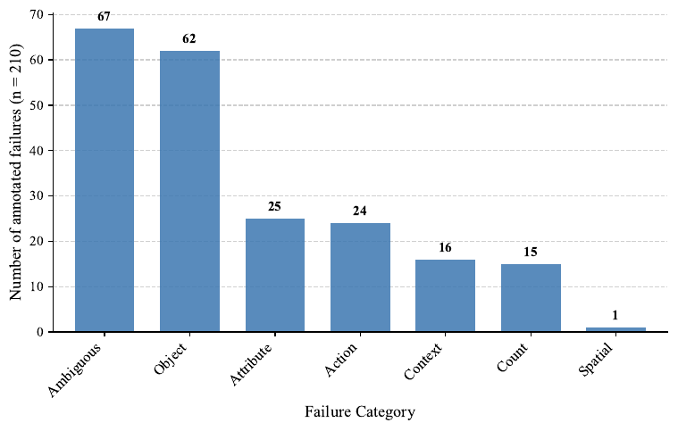

# Where Does CLIP Retrieval Fail?

A failure-analysis study of zero-shot **text→image retrieval** with CLIP (ViT-B/32) on MS-COCO 2017 val.
Instead of stopping at Recall@K, we sample the model's top-1 failures, label *why* each one failed with a
human-annotated taxonomy, and test whether a training-free fix (prompt ensembling) helps the failure types
it targets.

> **Context.** Team course project for STATS 302 at Duke Kunshan University. I designed and implemented the
> pipeline and the analysis; teammates contributed to the failure annotation.

---

## Main findings

**1. About a third of "failures" are not clearly model errors.**
Of 210 failure annotations, **31.9% are *Ambiguous***: the caption is underspecified, or the retrieved image
fits the caption about as well as the ground truth. Raw R@1 therefore *understates* CLIP's real accuracy on
this benchmark. The most common clear-cut errors are **Object** confusion (29.5%), **Attribute** (11.9%) and
**Action** (11.4%). Spatial errors almost never appear (1 case).



**2. The taxonomy is only moderately reliable.**
On the 20 failures that two annotators labeled independently, raw agreement is **55%** and Cohen's **κ ≈ 0.43**
(the overlap set was 30 items, but only 20 have a matched pair in `annotations_clean.csv`). The 9 disagreements
are spread across categories; the most frequent is Object vs. Ambiguous (2 of 9). Treat the category percentages above as
approximate. Any automatic labeler should be measured against this human–human ceiling, not against 100%.

**3. Prompt ensembling gives small gains on the failure subsets, but those gains are preliminary** (see the caveats below).

| Failure subset | n | Baseline R@5 / R@10 | Best ΔR@5 | Best ΔR@10 |
|---|---:|---|---:|---:|
| Object + Attribute | 87 | 36.8 / 51.7 | +6.9 pp (mean, logsumexp) | +1.1 pp |
| Object | 62 | 33.9 / 51.6 | +4.8 pp (logsumexp) | +3.2 pp |
| Attribute | 25 | 44.0 / 52.0 | +4.0 pp (mean, logsumexp) | 0 |
| Action | 24 | 33.3 / 45.8 | +4.2 pp (max) | +20.8 pp (all) |

All four rows have baseline R@1 = 0, because they are R@1 failures by construction. Each caption is expanded
into K = 10–15 templates and the similarities are pooled with max / mean / logsumexp (τ = 1).

For reference, the full-set baseline (5,000 images, 25,000 captions) is **R@1 30.4 / R@5 54.8 / R@10 66.2**.

---

## Caveats: what these numbers do *not* show yet

I'm listing these explicitly because each one could change the conclusion of finding 3.

1. **Evaluation only on selected failures.** The subsets are R@1 failures, so R@1 can only go up, and
   near-misses easily cross the R@5 and R@10 cutoffs. The method was never run on the full 25k captions,
   so any harm to the ~30% of captions CLIP already gets right goes unmeasured.
2. **Templates are chosen using the human label.** "Category-aware" templates are picked from the
   *annotated* category. That label doesn't exist at test time, so this is an oracle setting.
3. **No placebo control.** The run that would separate "category-aware prompting helps" from "any extra
   templates help" is missing: generic templates, or templates from the *wrong* category.
4. **Small n and many comparisons.** For example, Action ΔR@10 = +20.8 pp corresponds to 5 of 24 captions.
   The results span 4 subsets × 3 pooling methods × 3 metrics. Bootstrap CIs (`src/bootstrap_ci.py`) were
   computed for Action only.
5. **Some captions appear twice.** The 210 annotations cover 190 unique captions, because double-annotated
   items are kept twice. Subset sizes above count rows, not unique captions.

### Control experiments (caveats 1–5)
`src/control_experiments.py` applies **every** template set (generic, each of the 6 category sets,
Object+Attribute) with every pooling method to **all 25k captions**. It reuses the cached image embeddings and
records the ground-truth rank for each caption. `src/analyze_controls.py` then reports, with paired bootstrap CIs:

- **A.** Net ΔR@K on the full set, plus how many captions flip hit→miss vs. miss→hit.
- **B.** ΔR@K split into R@1 successes, all R@1 failures, and annotated failures. This tests for a selection effect.
- **C.** Annotated failures × template set, deduplicated. Matched (oracle) templates are compared against
  generic and wrong-category templates.
- **D.** A reproduction check against the numbers in the table above.

```bash
python src/control_experiments.py     # needs outputs/cache from src/main.py; a few minutes on a GPU
python src/analyze_controls.py        # CPU only; writes outputs/controls/controls_report_mean_R5.md
python src/analyze_controls.py --pooling max --k 10
```

Results: *pending*.

---

## Method at a glance

```
COCO val (5k images, 25k captions)
  └─ CLIP ViT-B/32 embeddings (cached) ──► baseline Recall@K
       └─ R@1 failures (17,389) ──► random sample of 200 (seed 42)
            └─ human annotation: 7-way taxonomy + overlap set for agreement
                 └─ per-category prompt ensembling + pooling ablation ──► ΔRecall@K, bootstrap CI
```

Taxonomy definitions: [`docs/failure_definition.md`](docs/failure_definition.md).
Annotation guide: [`docs/annotations_guide_en.md`](docs/annotations_guide_en.md) ([中文](docs/annotations_guide_cn.md)).

---

## Quickstart

```bash
conda create -n clip_failure python=3.9 -y
conda activate clip_failure
pip install -r requirements.txt
```

1. Download COCO 2017 val images and `captions_val2017.json` into `data/`. The exact layout is in [`docs/REPRODUCE.md`](docs/REPRODUCE.md).
2. Compute and cache embeddings, then report the baseline:

   ```bash
   python src/main.py
   ```

3. Re-run one improvement experiment from the committed annotations:

   ```bash
   python src/improve_subset.py --annotations_csv failure_analysis/analysis_all/annotations_clean.csv --include_categories Object --do_prompt_ensemble --pooling logsumexp --tau 1.0
   ```

The full pipeline (failure sampling, annotation merging, all ablations, figures) is documented in
[`docs/REPRODUCE.md`](docs/REPRODUCE.md). The batch runners in `scripts/` are Windows `.bat` files.

## Repository layout

```
src/                     pipeline scripts (baseline, failure sampling, improvement, bootstrap, figures)
failure_analysis/        annotations_clean.csv (the human labels used in all results)
docs/                    taxonomy definition, annotation guides, baseline + improvement notes, REPRODUCE.md
report/                  course report draft
figs/                    report figures (PDF; PNG copies in figs/png/)
configs/, scripts/       run config and Windows batch runners
```

## References
- Radford et al., 2021. *Learning Transferable Visual Models From Natural Language Supervision.*
- Lin et al., 2014. *Microsoft COCO: Common Objects in Context.*
